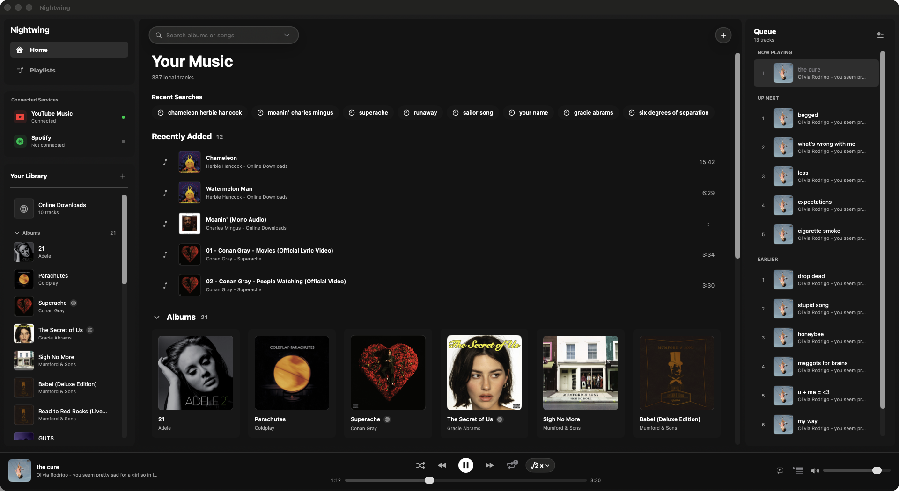

Local-first music playback with a Nightcore twist. Built with SwiftUI for macOS and iPhone, with a downloadable Mac Developer Preview.

[**Download for macOS**](https://github.com/rayzhudev/nightwing/releases/tag/v0.3.0-dev-preview.1) · [Install guide](docs/Public/INSTALL.md) · [Release notes](docs/Public/RELEASE_NOTES.md) · [Report an issue](https://github.com/rayzhudev/nightwing/issues)

> **Developer Preview · 0.3.0 (3)** — Requires **macOS 26+**, on Apple Silicon or Intel. The app is Developer ID signed but **not notarized**. For the first launch, use macOS **Open Anyway** as described in the [short install guide](docs/Public/INSTALL.md#install). This is an evaluation build; updates are installed manually. No iPhone binary is available yet.

## Features

- **Nightcore Playback.** Increase playback speed by √2 for a +6-semitone pitch shift, or adjust speed and pitch independently.
- **Local Library Playback.** Play imported audio files and folders, including FLAC, with albums, playlists, queues and watched folders. Original audio files are not modified.
- **Download Songs from YouTube Music.** Search for songs and albums, download audio, and play it in Nightwing on macOS.
- **On-Device Generated Lyrics.** On-device transcription on macOS using the Whisper Small model (Systran/faster-whisper-small). Synced lyrics from LRCLIB when available.
- **Import Playlists from Spotify and YouTube.** Import playlist metadata and order, and match locally available tracks. Service audio is not imported.
- **macOS Accent Colour.** Controls, highlights and selection use your macOS accent colour by default. Choose a custom colour in Settings > Appearance.

## Get started

1. [Download the preview ZIP and matching checksum](https://github.com/rayzhudev/nightwing/releases/tag/v0.3.0-dev-preview.1).
2. Follow the [install guide](docs/Public/INSTALL.md#install) to verify the download, move **Nightwing.app** to **Applications** and complete the first launch.
3. Use **Add Files** or **Add Folder** to import your music. Pick a song to play, then try **Nightcore** in the playback controls.

**Local import and playback work offline**—no account, Homebrew or extra tools needed. Keep your original music files where Nightwing can access them.

### Optional extras

Online downloads in the current Developer Preview require locally installed media tools. See [optional feature setup](docs/Public/INSTALL.md#optional-features) for the short setup path.

Use only content you are entitled to download and follow provider terms. See [optional feature setup](docs/Public/INSTALL.md#optional-features) for lyrics and transcription; [playlist connection setup](docs/Public/CONNECTIONS.md) requires your own Google/Spotify developer clients.

## Help and project details

Found a bug? [Check existing issues or open one](https://github.com/rayzhudev/nightwing/issues) with your app/macOS version, Mac architecture, reproduction steps and exact error. Redact credentials, personal paths and private playlist data. Preview support is best-effort.

- [Install, backup, recovery and uninstall](docs/Public/INSTALL.md)
- [Privacy and network access](docs/Public/PRIVACY.md)
- [Third-party notices](docs/Public/THIRD_PARTY_NOTICES.md) · [Dependency provenance](docs/DEPENDENCY_PROVENANCE.md)
- [Licence positioning](docs/Public/LICENSE.txt) — source is public; no project-wide open-source licence has been granted.
- [Build and test](docs/DEVELOPMENT.md) · [Preview identity and verification](docs/DEVELOPER_PREVIEW.md)
